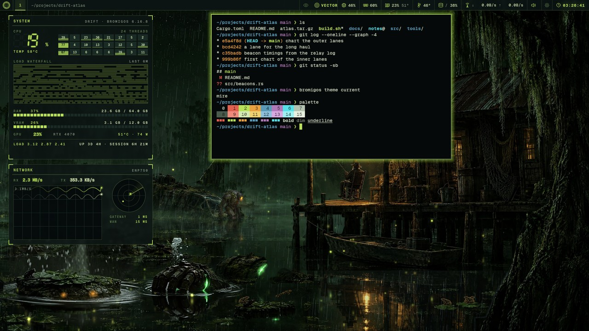
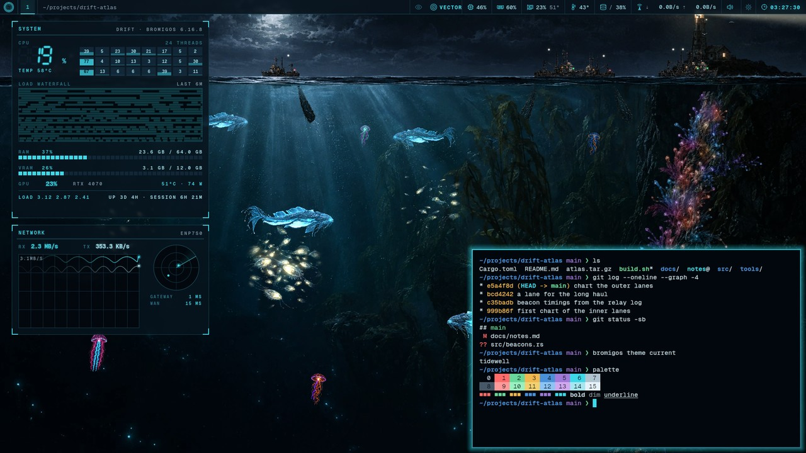
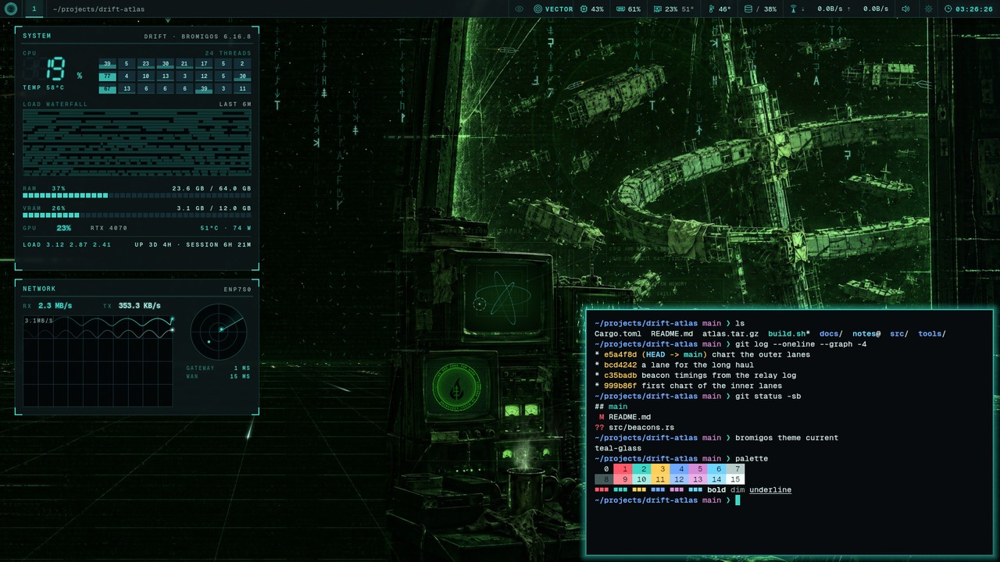

<p align="center">
  
</p>

# bromigOS extensions

[](https://github.com/bromigos-org/extensions/actions/workflows/check.yml)

This repository is the catalog of extensions for bromigOS. An extension adds one thing
to the desktop, such as a theme, a widget or a tool for VECTOR, bromigOS's desktop AI.
Each extension is a git repository, or a folder in one, with a manifest file named
`bromigos-ext.toml`.

The catalog is one file, `index.toml`, with an entry per extension. The `bromigos ext`
command reads it to search and to install by name. The theme switcher reads it too, and
shows the catalog's themes after your own.

This repository also holds working examples, previews and the check that CI runs. See
[What's in this repository](#whats-in-this-repository).

<p align="center">
  
  
  
</p>
<p align="center"><sub>Three of the catalog's themes: Mire, Tidewell and the Teal Glass example. Each picture is the theme switcher's own preview.</sub></p>

## Find and install an extension

```sh
bromigos ext search                   # list every extension in the catalog
bromigos ext search --kind theme      # list only the themes
bromigos ext info hello-deck          # show what it would install and the permissions it asks for
bromigos ext install hello-deck       # install it by name
```

A theme installs straight away, because it is only data. Anything else shows its parts
and the permissions it declares, then installs only if you type yes at a terminal.
When the install finishes, it tells you how to start what you installed.

To browse in a window instead, run `bromigos extensions`, or open Extensions from the
app launcher.

Updating, removing and disabling extensions are covered in the bromigOS manual's
[Extensions](https://github.com/bromigos-org/bromigOS/blob/main/manual/src/extensions.md)
page.

## Kinds of extension

Each part of an extension has a kind. One extension can provide several parts.

| Kind | What it adds | Example here |
|---|---|---|
| `theme` | Colours, backgrounds, or a painted world | [teal-glass](examples/teal-glass) |
| `live-deck` | A deck, a full-screen hologram you open with `bromigos-live plugin NAME` | [hello-deck](examples/hello-deck) |
| `live-layer` | A shader layer drawn over the live background | |
| `widget` | A panel on the desktop | [load-panel](examples/load-panel) |
| `vector-tool` | Tools that VECTOR can call | [uptime-tool](examples/uptime-tool) |
| `vector-memory` | A memory store for VECTOR | |
| `vector-skill` | A skill, a Markdown guide that VECTOR loads when a question needs it | |
| `homelab-adapter` | Support for one kind of homelab service | [this-host](examples/this-host) |
| `command` | A new `bromigos GROUP NAME` command | |
| `hook` | A program that runs after every `bromigos theme set` | |

Every kind has a starter. `bromigos ext new KIND NAME` makes one, so the kinds without an
example here are one command away.

## Make an extension

Start from a starter. It works as soon as it is created.

```sh
bromigos ext new live-deck my-deck        # create ./my-deck, a deck that already runs
bromigos ext validate my-deck             # check the manifest, the parts and the permissions
bromigos ext install --copy ./my-deck     # install the folder as it is, uncommitted edits included
```

Edit the files, then run `bromigos ext update my-deck` to install your changes. To start a
theme from one you already have, run `bromigos theme new NAME --from wick`, with any
installed theme in place of `wick`.

The README in each example says how to try that kind. The full reference is bromigOS's
[docs/extensions.md](https://github.com/bromigos-org/bromigOS/blob/main/docs/extensions.md).
It covers the manifest, permissions, the install ledger, updates and how VECTOR's guard
treats extensions.

## Publish an extension

1. Push it to a git repository. Put `bromigos-ext.toml` at the repository's root, or in a
   folder. Add a licence and a README. If it has commands or hooks, commit them as
   executable.
2. Tag a release, so people can pin it.

   ```sh
   git tag v1.0.0 && git push --tags
   ```

Anyone can now install it from its URL, for example
`bromigos ext install https://github.com/you/thing@v1.0.0`. If the extension is in a
folder, they add `--path FOLDER`. Without a tag, an install follows your default branch.

## List an extension in this catalog

Listing an extension here lets people find it with `bromigos ext search` and install it
by name.

1. Add an `[[extension]]` entry to `index.toml`. The fields are below.
2. Add a preview to `previews/`. It must be a PNG, JPEG or WebP under 1 MB. For a theme,
   render the switcher's own preview of the desktop wearing it.

   ```sh
   bromigos theme previews --dir path/to/theme --out previews/NAME.jpg
   ```

3. Run the catalog check. It needs Python 3.11 or newer and the `jsonschema` package.

   ```sh
   python3 -m venv /tmp/venv && /tmp/venv/bin/pip install jsonschema
   /tmp/venv/bin/python tools/check.py
   ```

   It prints each error, then a count such as `7 entries, 0 errors`.
4. Open a pull request. CI runs the same check on every push and pull request.

The check reads the listing, not the code. When someone installs an extension that
runs code, they see its declared permissions first and decide for themselves.

### Entry fields

| Field | Required | What it holds |
|---|---|---|
| `name` | Yes | The extension's name, exactly as its manifest gives it |
| `description` | Yes | One line on what it is |
| `kinds` | Yes | The kinds of the parts it provides, such as `["theme"]` |
| `url` | Yes | The git repository, starting with `https://`, `ssh://` or `git@` |
| `display_name` | No | The name people see, such as `Teal Glass` |
| `path` | No | The extension's folder, when it isn't at the repository's root |
| `ref` | No | A tag or branch to install instead of the default branch |
| `preview` | No | A picture in `previews/`, or an `https://` URL |
| `tags` | No | Words that help search find it |
| `bundled` | No | `true` for an extension that ships with bromigOS |

All nine of bromigOS's own themes ship with it: Wick (the default), the Mire and Tidewell
worlds, and the colour themes Rime, Sunder, Cinder, Lowtown, Highwind and Deepvein. They
are listed with `bundled = true` so search shows them, and there is nothing to install.

## What's in this repository

| Path | What it is |
|---|---|
| `index.toml` | The catalog |
| `examples/` | One working extension for each of five kinds, made with `bromigos ext new` |
| `previews/` | The pictures that search and the theme switcher show |
| `schema/` | JSON Schemas for `bromigos-ext.toml` and `index.toml` |
| `tools/check.py` | The catalog check |
| `.github/workflows/check.yml` | The CI job that runs the check |
| `.github/assets/` | The logo at the top of this README |
| `.github/ISSUE_TEMPLATE/` | The forms for a bug report or a listing request |
| `SECURITY.md` | How to report a harmful extension or a security problem, privately |
| `CODE_OF_CONDUCT.md` | The Contributor Covenant, the rules for taking part here |

To get completion and checks while you edit a manifest, point your editor's TOML schema
setting at `schema/bromigos-ext.schema.json`.

## Licence

MIT OR Apache-2.0, at your option. See `LICENSE-MIT` and `LICENSE-APACHE`. Each example
is under the same terms. An extension listed from elsewhere keeps its own licence.
